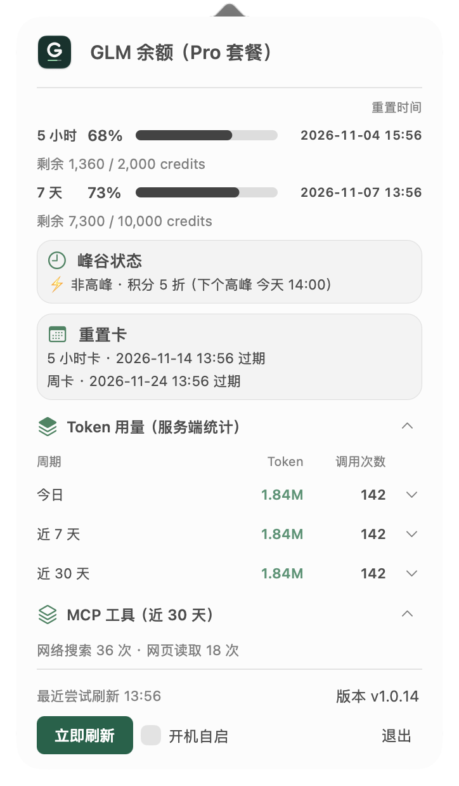

# GlmUsage

**GLM Coding Plan 额度与用量，在 Mac 菜单栏一眼看清。**

无需反复打开网页：查看剩余积分、重置时间和套餐状态，也能回顾 Token 趋势、调用次数与重置卡。

**[下载 GlmUsage](https://github.com/JUNX7764/Glmusage/releases/latest)** · macOS 13 或更高版本 · Apple Silicon

截图使用演示数据，展示当前版本界面。

## 能做什么

- **额度与套餐**：菜单栏显示 5 小时和 7 天剩余比例，点开查看剩余积分、重置时间与套餐到期时间。
- **周期用量与模型明细**：查看今天、近 7 天和近 30 天的 Token 与调用次数，点击周期行展开模型明细。
- **Start Plan 补统计**：将本机 ZCode 已记录的 Start Plan 赠送用量合并到周期汇总、模型明细和每日趋势。
- **每日趋势与对比**：近 30 天柱状图支持按日查看，并提供日环比、7 日环比；零值、缺失与数据不足分别展示。
- **重置卡与峰谷状态**：查看 5 小时卡、周卡数量及到期时间，确认后手动使用；同时查看当前峰谷时段与积分折扣提示。
- **面板背景**：页头可切换纯色、经典毛玻璃或液态玻璃（macOS 26 及以上），选择会自动保存。
- **MCP 工具与日常管理**：查看近 30 天网络搜索、网页读取次数；支持手动刷新、开机自启、面板内更新进度及异常或过期提示。

## 统计口径

服务端额度与用量来自智谱 / ZCode。Start Plan 补统计来自本机 ZCode 请求记录，只覆盖本机已记录的请求，**其他设备的赠送用量无法计入**；缺少本地记录时沿用服务端统计。

每日趋势与周期对比使用合并后的用量数据。MCP 工具次数来自服务端统计。重置卡信息需要有效的 ZCode 登录状态，用卡前会二次确认，不会自动消耗。

## 安装

1. 前往[下载页面](https://github.com/JUNX7764/Glmusage/releases/latest)，下载 `GlmUsage.dmg`。
2. 打开安装包，将 GlmUsage 拖入「应用程序」，然后打开。图标会出现在屏幕顶部菜单栏。
3. 在菜单栏打开 GlmUsage，点击「连接套餐」，输入 GLM Coding Plan 的 API Key。验证通过后会立即刷新额度和用量。使用旧版 ZCode 的用户可以沿用已连接的账号。

首次打开如遇 macOS 安全提示，可在 Finder 中右键点击 GlmUsage，选择「打开」并按提示操作。应用目前使用 ad-hoc 签名。

使用新版 ZCode 的用户可以通过套餐 API Key 恢复菜单栏的服务端额度和用量。API Key 可在个人编程套餐的「套餐概览」或团队编程套餐的「我的套餐」获取。重置卡可在 ZCode 的「使用统计 → 编程套餐」查看和使用。[智谱 API Key 获取说明](https://docs.bigmodel.cn/cn/coding-plan/extension/coding-tool-helper) · [ZCode 使用统计说明](https://zcode.z.ai/cn/docs/usage-stats)

## 更新

有新版本时，面板会显示更新提示。点击后先在面板内查看版本说明，确认下载后可查看下载和安装进度；关闭面板不会中断更新，重新打开仍可查看进度，完成后应用会自动重启。旧版本首次升级时，更新界面可能有所不同。

## 数据与隐私

**应用在 Mac 本地运行，不会把用量数据上传到开发者服务器。**

额度和用量由智谱或 ZCode 服务及本机 ZCode 请求记录提供，查询时会向对应服务发送必要的认证信息。手动连接的套餐 API Key 保存在 GlmUsage 的 macOS 钥匙串条目中。ZCode 凭据和本机请求用量只读，检查更新会连接 GitHub。

## 其他工具

[CodexUsage](https://github.com/JUNX7764/Codexusage) · [KimiUsage](https://github.com/JUNX7764/kimi-usage-menubar)

[开发者说明](docs/DEVELOPMENT.md) · [MIT License](LICENSE)
